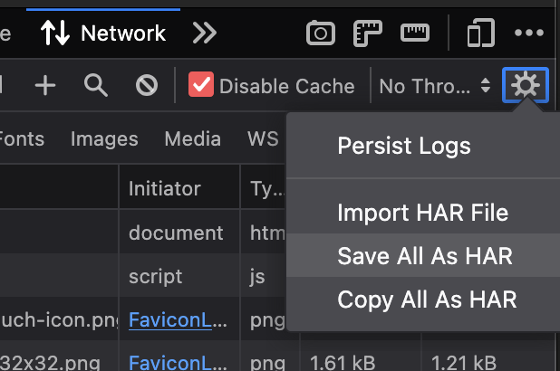
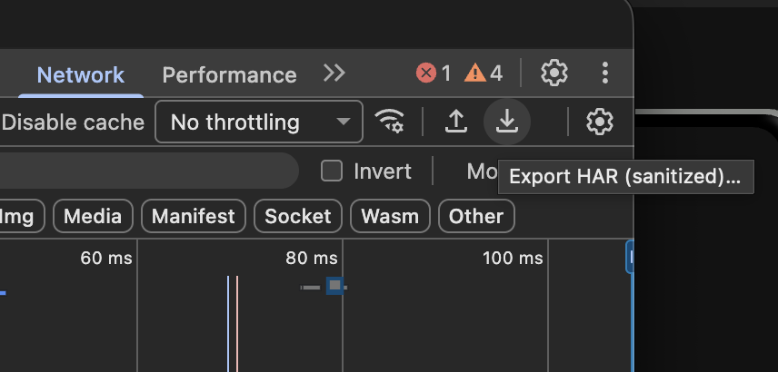

# Website Palette Extractor

Extract the color palette a website actually uses, and render it as a
self-contained interactive page.

Values are **read from the site's stylesheets**, not sampled from a screenshot,
so they are the exact declared colors rather than pixels that have been through
antialiasing and JPEG compression.

Python 3.11+ (tested on 3.11 through 3.14). The core takes three pure-Python
dependencies – `tinycss2` to tokenize the CSS, `cssselect2` to match and weigh
selectors, and `html5lib` to build the real document tree those selectors are
matched against – which are installed for you. `pillow` and `numpy` are extra –
only required if you want to use `--images`.

```bash
python3 -m website_palette_extractor site.har --images --fonts -o "palettes/site"            # from a HAR export (best)
python3 -m website_palette_extractor https://example.com --images --fonts -o "palettes/site" # directly pulling a site
python3 -m website_palette_extractor ./saved-page/ --images --fonts -o "palettes/site"       # local HTML / CSS
open palettes/site/index.html
```

Or if using `uv`:
```bash
uv run -m website_palette_extractor site.har --images --fonts -o "palettes/site"            # from a HAR export (best)
uv run -m website_palette_extractor https://example.com --images --fonts -o "palettes/site" # directly pulling a site
uv run -m website_palette_extractor ./saved-page/ --images --fonts -o "palettes/site"       # local HTML / CSS
open palettes/site/index.html
```

There is also `website_palette_extractor.pyz`, which is a version of the app that comes completely self-contained
with all the necessary dependencies so it can be run with just Python installed:
```bash
python3 website_palette_extractor.pyz site.har --images --fonts -o "palettes/site"
# or
uv run website_palette_extractor.pyz site.har --images --fonts -o "palettes/site"
```

Or the app can be installed, which puts a `website-palette-extractor` command on your path and makes
it available from anywhere:
```bash
pip install .            # core: pulls in tinycss2 + cssselect2 + html5lib
# or
pip install ".[images]"  # adds pillow + numpy for --images

# then
website-palette-extractor site.har -o "palettes/site"
```

## Input

\* _**[Note]** HAR exports are preferred_

A HAR export is what the browser actually loaded, so it includes stylesheets
injected at runtime and works on sites that refuse automated requests.

To generate a HAR export for a site, follow these steps:

### Firefox
1. Open `DevTools`
    - Right-click → `Inspect`
    - [MacOS] `Option + Cmd + I`
    - [Win] `Ctrl + Shift + I`
2. `Network` tab
3. `Clear` (trash can icon in the top left)
4. `Reload`
5. Let the page finish loading, then click the gear next to the `Throttling` menu and select `Save All As HAR`



### Chrome
1. Open `DevTools`
    - Right-click → `Inspect`
    - [MacOS] `Option + Cmd + I`
    - [Win] `Ctrl + Shift + I`
2. `Network` tab
3. `Clear` (universal "no" icon in the top left)
4. `Reload page`
5. Let the page finish loading, then click the download icon next to the `Throttling` menu



`--images` additionally checks whether the artwork carries color the CSS does
not. On an image-led site that is worth knowing before you trust a
stylesheet-only reading.

Passing a URL works, but the page is fetched without running JavaScript. Colors
applied at runtime will be missing, and many sites return 403 to a non-browser
request. The tool says so rather than silently returning a thin palette.

## Output

| File | What it is |
|---|---|
| `index.html` | Interactive palette. Standalone – no server, no network. |
| `*.json` | Canonical. Every token in hex/rgb/hsl/oklch, with provenance, contrast, and where each color was used. |
| `*.css` | Custom properties. |
| `*.scss` | Variables plus a map. |
| `*.ts` | Typed const object and a key union. |
| `*.tailwind.js` | A `theme.extend.colors` block. |

The page lets you switch the copy format between hex, rgb, hsl, oklch and
as-declared, toggle unrendered colors, and see the selector each color came
from. Click any swatch to copy it.

#### The JSON is a versioned, public API
`website_palette_extractor.emit.to_document()` returns the same dict the file
holds, and it carries a top-level `schemaVersion` (currently `1`). That is a
separate number from the package version in `pyproject.toml`: the package version
tracks the tool, the schema version tracks this one document shape, and the two
move on their own schedules. The compatibility promise: adding a key never bumps
`schemaVersion`; removing a key or changing what type it holds does. Two
things are already load-bearing for any consumer written before themes
existed: `themes` is always present and holds at least one entry, and the
top-level `ground`, `stats` and `colors` always mirror `themes[0]`.

A new *value* for an existing string key – `status` gaining `unmatched`
alongside `live`/`saved`/`inert` – does not bump it either, under the same
promise: the key is still present, still a string. A consumer that switches
on every status value it knows about and treats anything else as `live` (or
otherwise fails open) is unaffected; one that hard-rejects an unrecognized
status string should treat that as a bug in the consumer, not a signal this
tool should have bumped the version for.

Each entry under `examples` also carries `matchCount` – how many real
elements in the captured document that usage's selector actually reached,
not just its text. `null` means there was no basis to test it at all (no
captured HTML, a selector `cssselect2` can't evaluate, or one standing on an
interaction state such as `:hover`, which has no resting form to test); `0`
means it was tested and confirmed absent – the same evidence behind an
`unmatched` status, at the level of one usage rather than a whole entry. A
pseudo-element selector such as `.card::after` is *not* untestable: it is
tested against its base compound and answers whatever `.card` answers. When
`matchCount` is a positive number, a bounded `matches` array names a few of
the real elements (tag, id, classes, and a short ancestor chain) – omitted
entirely, not an empty list, when there is nothing real to show. A `reason`
string appears when `matchCount` is `null`, saying which of those cases it
was. All three are additive.

An entry whose every usage sits on an interaction state also carries
`dynamicOnly: true`. It stays `live` rather than becoming a fifth status:
no capture, however complete, could confirm or refute a `:hover` color, so
saying "unused" would be a claim the tool cannot support. The report
collects these under a **Caveats** section instead of hiding them.

A page with any typography carries a top-level `fonts` key too – additive,
same promise, `schemaVersion` unchanged. It never holds raw font bytes, even
with `--fonts`; see [Typography](#typography) below.

## Light and dark themes

When a site ships two themes, both are extracted and the report gets a toggle.

Three mechanisms are recognized: a `prefers-color-scheme` media query; a class
or attribute on a wrapper element – `.dark`, `.theme-dark`, `.is-light`,
`[data-theme="dark"]`, `[data-bs-theme=dark]`; and a `light-dark()` value. The
second is the common one, since Tailwind's `dark:` variant compiles to it. The
third needs no wrapper and no media query at all – a site can declare its whole
dark theme by writing `light-dark(#fff, #18191b)`, and each palette reads the
branch that belongs to it.

Each theme is extracted from scratch rather than tagged onto one pass, because
a theme has its own ground – so every contrast ratio you see is measured
against the background that theme actually uses, and colors with alpha are
flattened over the right one. Switching the toggle restyles the whole report,
not just the swatches.

The two palettes share one set of token names, paired by rank within each group
against that theme's own ground. So `ink-2` is the strongest body text in both,
and you can read a theme switch as one value changing rather than two unrelated
lists. The `.css` file uses this directly:

```css
:root                                  { --c-ground: #ffffff; … }
@media (prefers-color-scheme: dark) {
  :root                                { --c-ground: #0b0f14; … }
}
[data-theme="dark"]                    { --c-ground: #0b0f14; … }
```

Both forms are written because there is no telling which one your project uses
– delete the one you don't want.

The JSON grows a `themes` array and a `defaultTheme`; the top-level `ground`,
`stats` and `colors` still mirror the default theme, so anything already
reading the file keeps working. **The scss, ts and tailwind outputs carry the
default theme only.**

A site with no theme scopes produces exactly what it did before – one palette,
no toggle. `--no-themes` forces that.

One caveat, for sites storing theme colors as bare channel triplets
(`--background: 0 0% 3.9%`, the shadcn/ui pattern). Assembled at the point of
use – `hsl(var(--background))`, including `hsl(var(--x) / 50%)` and
`rgb(var(--x))` – those read normally and end up in the palette.

Used raw, as `background-color: var(--background)`, they do not, and that is
correct: `background-color: 0 0% 3.9%` is invalid CSS, so a browser discards it
and paints nothing. Reading a color there would put something in your palette
that the page never shows. You get a note saying so, rather than a silently
thin result.

You also get a note when a theme's ground had to be inferred – when nothing
sets a readable background on `html`, `body` or `:root`, usually because the
page is painted from a wrapper element. Every contrast ratio in that theme is
measured against the inferred ground, so it is worth knowing.

## Typography

The report also gets a **Typography** section: every font family the
stylesheet declares, grouped, with the sizes and weights it's used at, an
occurrence count, and a badge – `Google` for a family served from Google
Fonts, `Custom` for a self-hosted `@font-face`, no badge when the family is
referenced by name but never defined in the CSS (a system font, whatever the
visitor's browser happens to provide). `font-family: var(--font-sans)` is
resolved the same way a color's `var()` is, and a size in `rem` is resolved
against the page's own root `font-size` (16px if the page never sets one) –
`em`, `%`, `vw`, `clamp()` and `calc()` show the value exactly as declared
rather than a guessed pixel size, the same "never invent a value" rule
colors follow.

By default the sample text renders in the report's own fallback font –
metadata only, no extra network access or report size. Pass `--fonts` to
embed the site's real font files as `data:` URIs and see the actual glyphs:
for a `.har` target this uses only bytes the browser already fetched at
capture time (no new network access at all); for a live URL target it also
fetches the binaries the CSS points to. The JSON stays lean either way –
`fonts` never carries raw bytes, only metadata, the same way an `--images`
run never puts raw image bytes in the JSON.

Typography is extracted once for the whole document, not per theme – a site
whose fonts genuinely change between light and dark is read as whichever the
cascade resolves, unscoped.

## What it decides, and why

#### Ground is resolved by the cascade, not by counting
The page background is whichever background rule that lands on the page wins on
`importance → @layer → specificity → document order` – the same four terms a
browser applies, in the same order. Weighting by usage instead gets this wrong
on any site that loads a framework stylesheet before its own – which is most of
them. Everything else depends on this, since colors with alpha are flattened
over the ground and every contrast ratio is measured against it.

"Lands on the page" means the rule actually selects this document's `<html>` or
`<body>`, not just that it's written `body { … }`. Sites built with a utility
framework paint the page from the element – `<body class="bg-light-primary
dark:bg-dark-primary">` – and those classes beat the stylesheet's own `body`
rule. Reading the class attribute is the only way to tell that utility from the
identical-looking one sitting on a card.

#### Colors declared with alpha are reported both ways
1. Flattened to the hex you actually see, and
2. as originally declared, under `source.declaredAs`

#### Merging happens in OKLab, on the rendered color, within a role
`#1a1a1a` and `#191919` become one token. A grey used for body text and the same grey used
for a card background stay two, because they are two things in any theme worth
having. Use `--flat` for one token per distinct color instead.

#### Four statuses
- `live` – actually painted on the page.
- `saved` – a custom property nothing references. On sites built with a design
  tool this is usually the designer's saved swatches: real intent, not on this
  page.
- `inert` – a declaration that paints nothing, such as
  `drop-shadow(0 0 0 #13330d)` or `border: 0 solid #13330d`, where every length is zero.
- `unmatched` – every declaration's selector was checked against the page's
  own DOM markup and matched no real element there. Could be leftover CSS from an
  old design or an unused template variant; could also be a selector that only
  applies once client-side JavaScript runs – a toggled class, a modal, a
  route this capture never visited – which this tool cannot execute and so
  cannot rule out. Reported only
  when every use is a confirmed non-match; a single use this tool can't test
  (`:hover`, or a selector it can't parse) leaves the color `live` rather than
  guessing. `::after` is not one of those: a pseudo-element is tested against
  its base compound, so `.card::after` answers whatever `.card` answers.

Only `live` colors go into the css/scss/ts/tailwind files, so what you paste
into a project is what the site actually paints. Everything stays in the JSON
and the report, labelled.  
`--include-unused` overrides this.

#### Naming
Neutrals become `ink-N`, `surface-N`, `line-N`, ordered by
lightness. Colors with real hue get hue names from their OKLCH angle. The
chroma bar for "has a hue" is deliberately above the bar for "is achromatic":
the tinted greys every framework ships sit around 0.03 chroma and are greys
doing a grey's job, so calling one `blue-2` would be worse than useless.

## Framework and page-builder CSS

The biggest source of noise is a site's own platform. A page-builder or
component framework can contribute hundreds of colors that have nothing to do
with the design.

```bash
python3 -m website_palette_extractor site.har --list-sources
```

lists every stylesheet in cascade order with its color count, so you can see
the split, then:

```bash
python3 -m website_palette_extractor site.har --exclude bootstrap --exclude cdn.example.com
```

Third-party stylesheets are down-weighted by default rather than dropped;
`--all` disables that, `--no-third-party` drops them entirely.

Note that excluding a stylesheet also removes any `var()` references in it, so a
custom property defined in your CSS but consumed only by the framework will flip
from `live` to `saved`. That is accurate for the input you gave it, but worth
knowing before you read too much into a status.

## Options

```
-o, --out DIR         output directory (default: palette-out)
--all                 do not down-weight third-party stylesheets
--exclude TEXT        skip stylesheets matching TEXT (repeatable)
--flat                one token per color, ignoring role
--fonts               also embed the page's real font files in the HTML
                      report, for accurate Typography-section previews
--formats LIST        which outputs to write, comma-separated. Any of
                      html, json, css, scss, ts, tailwind (default: all)
--images              also quantise images (needs pillow + numpy)
--include-unused      put saved/inert colors in the code outputs too
--limit N             keep only the top N by score
--list-sources        show the stylesheets found, then exit
--merge D             OKLab distance below which colors merge (default 0.02)
--min-score F         drop colors scoring below F
--no-themes           treat a two-theme site as one theme
--no-third-party      ignore other-origin stylesheets entirely
--only TEXT           only read stylesheets matching TEXT (repeatable)
--prefix TEXT         CSS custom property prefix (default: c)
--quiet               suppress the summary
--timeout SECONDS     network timeout for URL fetches
--var-name TEXT       exported name in the TypeScript file
```

An unrecognised `--formats` value, or a negative `--limit`/`--merge`/
`--min-score`, is rejected before any work happens rather than quietly doing
something else.

## Limits worth knowing

#### No JavaScript is executed
A HAR captures styles that were injected before you exported, which covers most of it,
but a color computed in JS and appliedto an element property is not in any stylesheet
and will not be found.

#### The cascade is implemented where it decides an answer, and nowhere else
`importance → @layer → specificity → document order` resolves the page background and
what a custom property holds. It is not a cascade engine: every other declaration enters
the palette as written, because a palette wants every color a site declares rather than
the one that won on some element.

#### Scoped custom properties are modelled only as far as the captured page can prove
When a `var()`'s consuming element is in the captured markup, the real ancestor chain
decides which definition applies to it. When it isn't – a client-rendered page, or a
HAR that never fetched the page using it – the last definition in the document wins,
which is a guess and is sometimes the wrong one. `@property` is read for `inherits` and
`initial-value`; its `syntax` is not checked against the value stored.

#### Ranking is a heuristic
Score reflects where a color is used, not just how often. Treat the order as a strong hint, not a measurement.

#### `color-mix()` is evaluated in eleven interpolation spaces, and so is `light-dark()`
A mix whose space is one of the few not implemented is skipped whole – the colors written
inside it are not reported, because the page paints the mix and not its arguments. A `calc()`
percentage is evaluated when it is literal arithmetic (`calc(60 * 1%)`); one containing a
`var()`, a unit other than `%`, or anything else outside that subset skips the mix rather
than guessing at a percentage. Relative color syntax (`oklch(from white l c h)`) is not
evaluated. `lab()` and `lch()` are read – modern Tailwind emits them after a hex fallback,
so they win the cascade and skipping them would drop the color entirely.

#### Typography has no inheritance model, and is not per-theme
A selector that sets `font-size`/`font-weight` but relies on an ancestor for
its `font-family` is invisible to the Typography section – there is no real
inheritance walk for it the way there partly is for colors. Fonts are also
read once for the whole document rather than once per theme.

#### `@supports` is evaluated only far enough to be safe
A condition can confirm *supported* – a custom property, or a plain `<color>` property whose
value parses – and otherwise says it cannot tell, in which case the block is read as though it
always applies, exactly as before. That is enough to stop a `@supports not (color: light-dark(…))`
polyfill fallback from overriding the real value it was written to stand in for, without ever
dropping real CSS on a guess.

## Example

An [`example/`](./example/) directory holding a pre-generated report using my personal site
([https://parkersprouse.me](https://parkersprouse.me)) exists so you can see sample output without needing to run
anything yourself.

It was generated using the following command:
```bash
python3 -m website_palette_extractor parkersprouse.me.har --images --fonts -o example
```

I've included the `.har` in case you want to run it yourself.

## Tests

```bash
python3 -m unittest discover
```

Run it from an environment where the dependencies are installed:
```bash
pip install -e ".[dev]"`
# or
uv run --with tinycss2 --with cssselect2 --with html5lib python -m unittest discover
```
A bare system `python3` will fail at the `tinycss2` import rather than at an assertion.  
`pytest` also works, discovering the same [`tests/`](./tests/) package
([`tests/test_color.py`](./tests/test_color.py), [`tests/test_cssparse.py`](./tests/test_cssparse.py),
[`tests/test_dom.py`](./tests/test_dom.py), [`tests/test_extract.py`](./tests/test_extract.py),
[`tests/test_emit.py`](./tests/test_emit.py), [`tests/test_sources.py`](./tests/test_sources.py),
[`tests/test_images.py`](./tests/test_images.py), [`tests/test_main.py`](./tests/test_main.py),
[`tests/test_packaging.py`](./tests/test_packaging.py) – one per module in
[`website_palette_extractor/`](./website_palette_extractor/), plus one for the packaging metadata).

273 tests covering the color maths, cascade ordering, theme scoping, ground
detection, the merge rules, the status classifications, typography
extraction, the CLI's argument handling, and the optional image pass. Worth
running after any edit – several of these exist because the obvious
implementation was quietly wrong.

The image tests skip themselves when `pillow`/`numpy` are absent, so the suite
passes on a core install.

## License note

Color values are not copyrightable, so reusing a palette is fine. Fonts,
images, and the page itself are not covered by that – check separately before
reusing anything other than the numbers.
